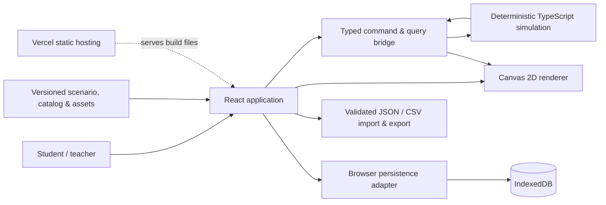
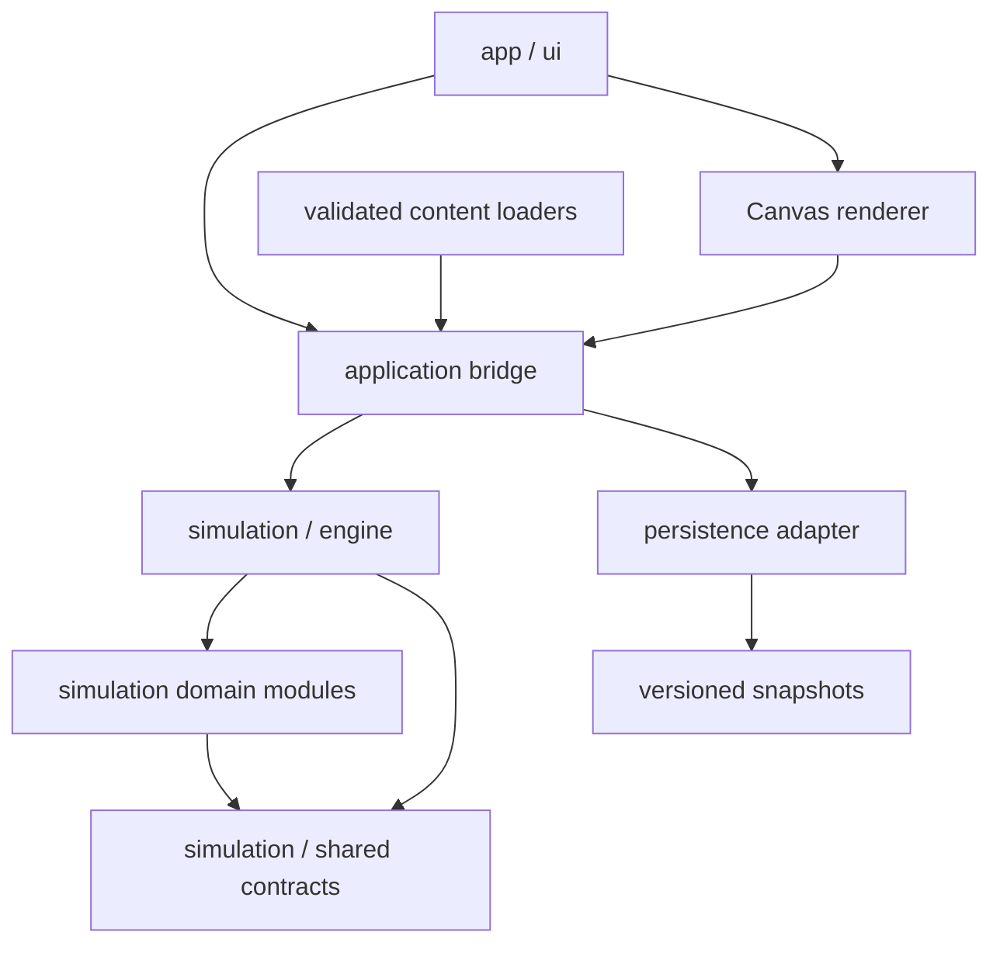
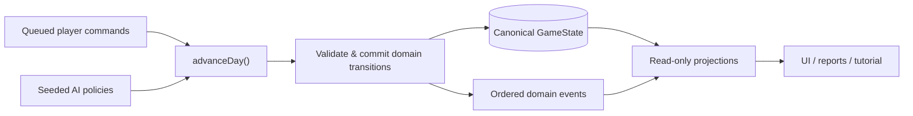
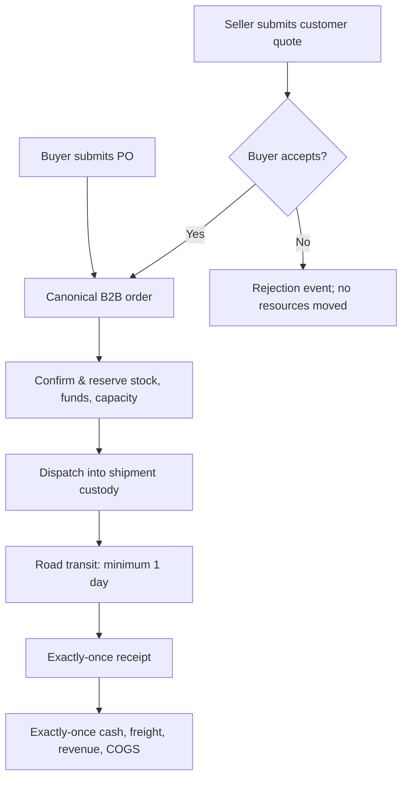

# Supply Chain Simulator — Software Architecture

**Document:** `ARCHITECTURE.md`  
**Status:** Normative target architecture (pre-implementation)  
**Baseline date:** 2026-11-21  
**Target release:** Release 1.0 (complete product, developed incrementally; no separately scoped MVP)  
**Primary language:** TypeScript (strict mode)  
**Target platform:** Browser, statically deployed on Vercel  
**Player-facing locale:** `pt-BR`  
**Internal code and technical documentation:** English

> **Architectural source of truth.** This file is authoritative for the software's structure: component boundaries, dependencies, state ownership, integration contracts, execution model, persistence boundaries, and architectural acceptance rules. It describes the *target design*, not a claim that the code already exists.

## 1. Authority, scope, and change control

The repository has distinct authoritative documents:

1. **`SPEC.md` — product and domain authority.** Defines gameplay behavior, business rules, numeric constraints, educational requirements, non-goals, and functional acceptance criteria.
2. **`ARCHITECTURE.md` — structural authority.** Defines how those requirements are partitioned into modules and how the modules may communicate. New code MUST conform to this architecture.
3. **`ROADMAP.md` — delivery sequencing.** Defines implementation milestones and exit gates, without redefining the domain.
4. **`TODO.md` — execution backlog.** Tracks work required by the product and architecture contracts.
5. **`README.md` — project overview.** Summarizes, but does not override, normative documents.
6. **Architecture Decision Records (ADRs), if added under `docs/adr/` — decision rationale.** ADRs document accepted choices and rejected alternatives. An ADR MUST NOT silently override either normative document.

**Conflict rule:** `SPEC.md` takes precedence on *what the simulation must do*; this document takes precedence on *where and how the implementation is structured*. If an architectural proposal changes game semantics, it requires an approved `SPEC.md` amendment first. Contradictions MUST be identified and resolved explicitly, not implemented by choosing whichever text is more convenient.

Changes to module ownership, dependency direction, runtime phase ordering, state authority, or public cross-module contracts MUST update this document in the same pull request as the code. Changes to gameplay constraints also require aligned `SPEC.md`, `ROADMAP.md`, `TODO.md`, and tests as applicable. Decisions not yet specified are documented in Section 19 rather than fabricated.

The terms **MUST**, **MUST NOT**, and **SHOULD** have normative meaning here.

## 2. Architectural goals

The architecture MUST:

- Support the complete specified Release 1.0 from the first development milestone, without mock economic behavior or temporary shortcuts that create conflicting rules.
- Remain deterministic: the same seed, compatible content/generator versions, and ordered commands produce the same state, event history, and financial outcomes.
- Keep simulation logic entirely independent of React, Canvas, the DOM, browser storage, and external services.
- Provide one canonical source for every game entity, stock balance, commercial order, shipment, ownership change, and financial entry.
- Allow the player and AI companies to use the same commands, validations, prices, ownership restrictions, and resource accounting.
- Scale to the default **160 × 120 tile city (19,200 tiles)** with **50 initial AI companies**, at least **40 active, independent, trade-accessible AI counterparties** at initial and completed-day boundaries, at least **15 supplier** and **15 B2B customer** options, and **60+ tradable SKUs in 10+ sectors**.
- Make behavior observable through localized explanations, state projections, events, and reproducible test evidence.
- Run as a client-side application without accounts, paid APIs, or a mandatory backend.
- Support complete local save/load, portable exports, and classroom comparison of fixed-seed scenarios.

**Design bias:** a modular, domain-oriented monolith with explicit application orchestration. Do not introduce microservices, server persistence, a distributed event bus, ECS, generic workflow frameworks, or complex dependency injection without an evidenced requirement and an approved architectural change.

## 3. System context and deployment



- **Deployment unit:** one browser application built with Vite and hosted as static files on Vercel.
- **User interface:** React. It handles navigation, accessibility, editing intents, status messaging, and read-only projections.
- **Simulation runtime:** strict TypeScript modules with no browser dependencies; usable in Vitest and Node-based simulation tests.
- **Map rendering:** viewport-culled Canvas 2D, backed by read-only world projections and locally served versioned visual assets.
- **Persistence:** IndexedDB adapter plus validated portable JSON files; no remote database.
- **AI:** deterministic local strategies, not an LLM or external agent service.
- **Reporting:** local CSV/JSON generation based on canonical state and event history.

An optional Web Worker may host the unchanged simulation runtime if benchmarks show main-thread blocking. Worker introduction MUST NOT fork economic logic, alter scheduler ordering, or compromise deterministic replay.

## 4. Layering and allowed dependencies

The architectural layers are:

1. **Presentation:** `app/` and `ui/`, including navigation, React components, accessibility, and Canvas adapters.
2. **Application boundary:** typed command submissions, queries/selectors, localized result mapping, and simulation-session control.
3. **Simulation orchestration:** deterministic scheduler, command queue, transaction coordination, event sequencing, and PRNG streams.
4. **Domain modules:** world, economy, procurement, inventory, production, logistics, finance, AI, and learning.
5. **Shared domain contracts:** stable IDs, integers/money, command/event envelopes, schemas, and pure utilities.
6. **Infrastructure adapters:** content loading, persistence, import/export, render assets, and optional worker transport.



**Dependency rules:**

- `src/simulation/**` MUST NOT import from `src/app/**`, `src/ui/**`, `src/persistence/**`, `src/assets/**`, React, browser storage APIs, or Canvas.
- Domain modules MAY import shared contracts and pure shared utilities. A domain MUST NOT directly mutate another domain's internal state.
- `simulation/engine` is the sole orchestrator for operations affecting several domain modules. It MAY call their exported validation and transition functions.
- Domain modules MUST expose typed, narrow entry points rather than importing each other's internal implementation files. Cyclic imports are forbidden.
- `ui` MUST NOT import internal mutable simulation stores or domain reducers. It receives projections and submits typed commands through the application bridge.
- Adapters MUST depend inward on stable interfaces. The simulation MUST NOT know which storage, browser, or UI adapter is in use.
- Cross-domain effects MUST be explicitly coordinated and represented by typed events. An event is an observed fact, not a command granting permission to bypass validation.
- Architectural dependency checks SHOULD run in CI. A rejected illegal dependency is a build failure, not a style warning.

## 5. Canonical repository structure

This is the **target directory contract**, not a list of currently existing files. It refines the suggested layout in `SPEC.md` §14.2 without changing the required domains. Names may be refined only through a documented architecture change.

```text
/
├── README.md
├── SPEC.md
├── ARCHITECTURE.md
├── ROADMAP.md
├── TODO.md
├── package.json
├── tsconfig.json
├── vite.config.ts
├── public/
│   └── assets/                  # Locally served, versioned game artwork
├── src/
│   ├── app/                     # Bootstrap, routing, session and providers
│   │   └── bridge/              # Commands, query facade, worker transport seam
│   ├── ui/                      # React presentation; no business authority
│   │   ├── city/                # Map view, overlays, selection, land details
│   │   ├── dashboard/           # Cash, revenue, profit, ROI, alerts
│   │   ├── orders/              # PO, SO, quotes, transfers and shipments
│   │   ├── facilities/          # Inventory, pricing and production panels
│   │   ├── market/              # Searchable supplier/customer directory
│   │   ├── learning/            # Tutorial, missions, feedback and reports
│   │   └── shared/              # Accessible, reusable visual components
│   ├── rendering/               # Canvas 2D renderer and spatial hit-testing
│   ├── simulation/
│   │   ├── shared/              # IDs, money, domain types, deterministic helpers
│   │   ├── engine/              # State, scheduler, PRNG, commands, events
│   │   ├── world/               # Generation, zoning, districts, roads, lots
│   │   ├── economy/             # Firms, facilities, offers, demand, prices
│   │   ├── procurement/         # B2B orders, quotes, commitments, transfers
│   │   ├── inventory/           # Stock, reservations, valuation
│   │   ├── production/          # Recipes, extraction, manufacturing
│   │   ├── logistics/           # Routing queries, shipments, receipt
│   │   ├── finance/             # Cash, ledger, assets, obligations, KPIs
│   │   ├── ai/                  # Firm decisions, entry, exit, liquidation
│   │   └── learning/            # Objectives and evidence evaluation
│   ├── data/                    # Versioned catalogs, scenarios, presets
│   ├── assets/                  # Asset IDs, metadata, licenses, fallbacks
│   ├── persistence/             # IndexedDB, save schema, migrations, files
│   └── localization/            # pt-BR dictionary, glossary, formatting
├── tests/
│   ├── unit/
│   ├── integration/
│   ├── scenarios/
│   ├── architecture/
│   └── e2e/
└── docs/
    └── adr/                    # Accepted and proposed decision records
```

Within each simulation domain, prefer a small consistent composition of `types.ts`, `rules.ts`, `commands.ts`, `events.ts`, `selectors.ts`, and focused pure functions **where useful**. Do not generate empty template files or deep abstractions merely to mimic this pattern. Tests can be colocated or reside under `tests/`, provided the chosen convention is consistent.

## 6. State ownership and domain boundaries

A single `GameState` is authoritative for the current simulation. It has normalized ID-keyed entity collections and well-defined ownership for each data field. **One concept has one writer.** Cross-domain transactions are committed through the engine; React state, caches, reports, and display models MUST NOT become alternative economic authorities.

| Module | Canonical ownership | May read / request |
| --- | --- | --- |
| `engine` | Clock, ordered commands, event sequence, PRNG state, transaction lifecycle | All domain APIs |
| `world` | Tile geography, zones, districts, roads, lots, road access and spatial attributes | Company/facility placement requests |
| `economy` | Company identity and lifecycle references, establishment records, offers, purchase requests, consumer demand and retail pricing | World access, inventory availability, finance status |
| `procurement` | Quotes, canonical commercial orders, order status, commitment linkage and internal transfer orders | Inventory, finance and logistics validation |
| `inventory` | Physical quantities, reservations, capacity commitments and stock cost basis | Facility capacity and shipment/production intents |
| `production` | Recipe execution, extraction and production records | Validated inventory and finance operations |
| `logistics` | Route calculations, shipment records, transit custody and delivery eligibility | Road graph and orders |
| `finance` | Cash, earmarked funds, assets, ledger entries, obligations and accounting projections | Posted transactions and operational events |
| `ai` | Decision-policy state, firm planning cadence, entry pipeline and liquidation workflow progress | Published read models of the economy |
| `learning` | Objectives, learner decisions/reflections and evaluation evidence | Command/event history and reporting projections |

The exact field types are versioned implementation contracts; the required separation is normative. For example, company records reference `facilityId` and `lotId` rather than copying ownership data into contradictory lists.

### 6.1 Canonical state composition

```ts
interface SimulationState {
  meta: {
    scenarioId: string;
    scenarioVersion: string;
    catalogVersion: string;
    generatorVersion: string;
    schemaVersion: number;
    seed: string;
  };
  clock: SimulationClock;
  randomStreams: RandomStreamStates;
  world: WorldState;
  economy: EconomyState;
  procurement: ProcurementState;
  inventory: InventoryState;
  production: ProductionState;
  logistics: LogisticsState;
  finance: FinanceState;
  ai: AiState;
  learning: LearningState;
  pendingCommands: readonly CommandEnvelope[];
  eventLog: readonly GameEventEnvelope[];
}
```

These names describe architectural boundaries, not a requirement that everything reside in one enormous object/file. Implementations MAY use persistent collections or transactional working copies while preserving the single authoritative logical state.

- Persistent entity references use stable IDs, never array positions, sprite references, or coordinates alone.
- Money is represented by **integer BRL cents**. Product quantities use **nonnegative integer trade units**.
- Financial, order, shipment, and inventory history is append-only or explicitly versioned; closing a company does not erase past facts.
- Derived data such as lookup indices, display translations, path caches, and chart series is rebuildable from canonical data and SHOULD NOT be independently authoritative.
- All domain state changes MUST produce sufficient typed events for audit and educational explanations.
- Selectors return read-only, immutable projections or defensive copies. A consumer MUST NOT be able to mutate state through a projection.

## 7. Commands, queries, events, and atomicity

The engine exposes a small application-facing API:

```ts
interface SimulationSession {
  submit(command: GameCommandEnvelope): CommandSubmissionResult;
  advanceDay(): DayAdvanceResult;
  query<T>(selector: SimulationSelector<T>): Readonly<T>;
  snapshot(): VersionedSaveEnvelope;
}
```

This is a **shape illustration**, not a frozen API signature.

### 7.1 Commands

- A command expresses an intent to change state, has a stable ID, issuer identity, scenario day, deterministic sequence position, typed payload, and validation result.
- The player and AI use the **same command processor** and permission/ownership/resource rules. The issuer changes authorization context, not economic privileges.
- The UI may queue a player intent between days and render a pending state. The scheduler freezes the next-day command batch as required by `SPEC.md` §11.
- Commands that fail domain validation MUST not modify canonical state, consume economic resources, or partially emit committed domain events. Rejections carry machine-readable reason codes for `pt-BR` presentation.
- Commands affecting multiple modules MUST execute as an atomic transaction. Validate prerequisites, calculate all effects, then commit the new state and its event batch together; otherwise reject with unchanged state.
- Duplicate command IDs, dispatches, receipts, settlements, and ledger posting keys MUST be detected as part of idempotency rules.
- `ADVANCE_DAY` is a simulation control operation; it is not an unvalidated way to write business state.

### 7.2 Domain events

Events represent committed facts such as `ORDER_CONFIRMED`, `GOODS_DISPATCHED`, `GOODS_RECEIVED`, `RETAIL_SALE`, `COMPANY_FOUNDED`, `COMPANY_CLOSED` and `DAY_COMPLETED`.

Each event MUST include a stable event ID, simulation day, sequence number, event type, and references to affected entities and originating command/transaction where applicable. Replaying effects MUST NOT double-apply them.

Events support the transaction journal, UI notifications, teacher evidence, testing, and diagnostic traces. They are not permission for arbitrary independent subscribers to mutate shared state outside the engine.

### 7.3 Queries

Selectors read canonical state and produce presentation-ready but domain-neutral projections: `CompanyOverview`, `FacilityInventory`, `SupplierComparison`, `CustomerDemand`, `OrderTimeline`, `MapViewport`, `DaySummary`, and `LearningEvidence` are expected examples.

Formatting into Portuguese and Brazilian monetary presentation happens in the localization/presentation boundary, never in canonical economic data.

## 8. Deterministic daily runtime

The daily scheduler is the **only authority for simulated time**. The order below MUST match `SPEC.md` §11:

1. Freeze the player-command batch for the next day and validate it.
2. Let AI companies create decisions in stable company-ID order.
3. Confirm or reject eligible orders and atomically establish reservations.
4. Dispatch ready confirmed orders.
5. Advance shipments and receive deliveries arriving today.
6. Process farm extraction and factory production using available inputs and capacity.
7. Allocate bounded household demand and post retail receipts.
8. Post daily operating expenses and applicable business financial events.
9. Evaluate company distress, founding, growth, retrenchment, liquidation, and closure; enforce the trade-accessible market floor and schedule entrants for next-day activation.
10. Recompute derived metrics and append the day summary and event log.
11. Advance the day counter.

**Temporal contracts:** goods produced in phase 6 cannot be dispatched during phase 4 of that same day. Orders submitted on day `d` cannot arrive before day `d + 1`. Founding and facility changes activated at the ecology boundary only become tradable in the next order phase, as specified.

**Deterministic execution rules:**

- Use explicit seeded PRNG streams for at least world generation, household demand, AI decisions, and market entry; stream state is stored and replayed.
- Never use `Math.random()`, wall-clock time, unstable object iteration, unordered asynchronous completion, or locale-dependent ordering for outcome-critical decisions.
- Use explicit stable sorting and documented tie-break keys wherever agents, orders, facilities, or demand contenders compete.
- Deterministic IDs are derived from stable sequences/counters or seeded mechanisms, not runtime UUID randomness.
- Canonical serialization and state hashing normalize key order and exclude rebuildable caches.
- Do not parallelize state-changing AI decisions or daily phases if doing so changes their evaluation order or outcome. Parallelize pure calculations only when results can be merged in a defined, deterministic order.
- Multi-day advancement is a repeat of single-day transitions, not a separate rules engine.



## 9. World, lots, routing, and visual separation

### 9.1 World-generation pipeline

A versioned, deterministic generator performs:

`macro roads and districts → local road blocks → zoning and lots → population/land values → company and facility allocation → route and market-coverage validation`.

The default world MUST be **160 × 120 tiles**, with all four zoning categories and enough legal, non-overlapping, road-connected lots for the starter establishment, 50 AI companies, residential demand, and later expansion. It MUST fail explicitly when a seed/configuration cannot satisfy the economic capacity constraints.

- **Tile:** compact terrain/render cell. No per-tile object requiring a React element.
- **District:** geographic and economic aggregation for population, accessibility, demand, and cached market queries.
- **Lot:** stable ID, validated contiguous tile footprint, zone, owner, price, connected road-access node, and optional facility reference.
- **Establishment:** economic entity belonging to a company and occupying one eligible lot.
- **Road graph:** connected, typed road edges and access nodes used by canonical logistics routing.

Zone compatibility is authoritative in `SPEC.md` §4.2: industrial → factory/warehouse; agricultural → farm/warehouse; commercial → store/warehouse; residential → no construction. One lot initially supports at most one operating establishment. Lot acquisition and construction are separate validated transactions.

### 9.2 Rendering

- Canvas 2D MUST use camera transforms, viewport culling, cached chunks/layers, and a spatial index for lot/facility hit-testing.
- Renderer inputs MUST be immutable world projections. A sprite, visual offset, tooltip, or hit-test result MUST NOT become a source of economic truth.
- Map layers include roads, districts, zoning, lots, facilities, company ownership, land price, accessibility, transport, and market competition.
- Asset lookup uses stable IDs and a versioned local manifest, including provenance and redistribution license checks. Missing artwork has a controlled fallback.
- No requirement may force a 19,200-element DOM tile tree, network image loading at runtime, or a visual agent per consumer.
- Economic routing depends on the road graph, **not** on drawing paths or animation.
- Lists and search allow facility and company access independently of map pointing and color recognition.

## 10. Companies, products, and market ecology

**Company ≠ establishment ≠ lot.** Companies may own many lots and establishments. Facilities have their own capacity, inventory, activity and operating cost. Company closure MUST NOT delete lots, stock, unpaid obligations, shipments, orders, or history without recorded resolutions.

The market catalog is data-driven and versioned: **60+ distinct tradable products spanning at least 10 sectors**, each with validated units, sources/recipes, prices, buyer eligibility, and reachable upstream/downstream pathways. Fruit, cheese, and furniture are tutorial chains, not the catalog's limits.

The standard scenario starts **50 AI companies**. At initial state and every completed-day boundary, it MUST expose **40+ independently active, road-reachable and trade-accessible AI companies**, with at least **15 supplier** and **15 B2B customer** options; roles may overlap. A company is counted only if its published offer and/or purchase opportunity is feasible and discoverable. The player is excluded from those counts.

The `ai` module proposes ordinary commands for purchasing, quoting, replenishing, pricing, production, facility investment, retreat, and lifecycle changes. The `economy` and relevant domain modules decide whether proposals are feasible. The engine owns fair ordering and execution.

**Entry/exit architecture:**

- Founding decisions read indexed unmet demand, sector opportunities, available sites, upstream feasibility, and available investor equity.
- New entrants MUST receive startup capital through a finite scenario-defined funding pool and a recorded equity event, not through unexplained balance creation.
- A seeded reserve candidate pipeline MAY maintain the company-count floor. Each candidate must pass normal land, funding, route, and product feasibility checks.
- Distress/insolvency must use the financial domain's authoritative cash and obligations. The AI lifecycle MUST NOT invent an independent accounting state.
- Liquidation is an explicit workflow for assets, open commitments, shipments, and obligations, with audit events and idempotent closure.
- If the configured city/funding cannot sustain the minimum market, scenario generation or validation MUST fail visibly; it MUST NOT silently lower thresholds or create synthetic counterparties.
- Firm founding, closure, and activation sequences are stored and replayable. Historical firms remain inspectable and cannot place new normal orders.

Scoring, policies, and AI cadence SHOULD operate on indexed sector/district/offer data rather than iterating over every tile for every firm.

## 11. Commerce, inventory, shipments, and finance

### 11.1 Single commercial-order authority

Every B2B transaction between different companies is represented by **one canonical `CommercialOrder`**. The buyer sees a PO projection; the seller sees an SO projection. These are **two views of one transaction**, never two independent trade records or two settlements.

Two valid initiation paths converge:

- **Buyer-initiated purchase:** select an actual seller offer; submit a PO.
- **Seller-initiated sale:** select an actual AI buyer's procurement request; submit a quote; deterministic buyer acceptance creates the canonical order.

Rejection cannot reserve resources or recognize revenue. An accepted quote must pass the same funds, seller stock, destination capacity, path, and ownership guards as a buyer-issued PO.



Order status and legal transitions MUST follow `SPEC.md` §7: `draft → submitted → confirmed → dispatched → in_transit → delivered`, with rejection or pre-dispatch cancellation where permitted.

### 11.2 Resource commitment boundaries

- `inventory` is authoritative for `onHand`, `reservedOutbound`, `reservedInboundCapacity`, valuation, and facility capacity.
- `finance` is authoritative for cash, committed purchase-plus-freight funds, assets, obligations, and ledger.
- `procurement` owns which order holds each commitment. The engine coordinates one atomic commit across the three domains.
- `logistics` owns physical shipment custody, arrival eligibility, and road-based lead time/freight calculations.
- Successful delivery transitions shipment stock to receiving inventory exactly once and triggers one financial settlement. No duplication through UI callbacks or event handlers.
- Internal stock transfers have a distinct transfer-order type; they preserve cost basis and never create consolidated external sales revenue/COGS.
- B2C household consumption produces bounded retail-sale receipts, not fictitious B2B company orders.

### 11.3 Financial rules and projections

The financial ledger is the sole authority for money movements and recognized results. Settlement is **on successful receipt** under the initial payment rule.

- Equity contribution is funding, not revenue.
- Property acquisition creates an asset, not an immediate operating expense.
- Inventory purchasing creates stock cost basis; COGS occurs on external sale.
- Production capitalizes consumed material and processing costs into completed inventory.
- Buyer-paid inbound freight contributes to landed inventory cost.
- Operating expenses reduce cash and profit; unpaid mandatory expenses are recorded as obligations and trigger the specified insolvency/suspension behavior.
- Negative profit/ROI is valid; negative cash and overcommitted spendable funds are not.
- Revenue, simplified net profit, ROI, cash, inventory value, service levels, and utilization MUST be computed from canonical state/events, not maintained as editable UI values.

**Ledger integrity:** use stable posting IDs tied to originating economic facts; reject duplicate posting keys. Reconcile balances and stock valuations with event history in automated tests. Accounting policy details not fixed by `SPEC.md` are governed by the explicit decisions in Section 19.

## 12. Production, demand, and education

Production recipes and farm source rules are versioned content. A factory consumes required inputs, checks cash and capacity, and creates outputs with lawful cost basis. Farms generate resources only through configured cost/throughput rules. Warehouses store and transfer without transformation. The engine enforces one-day processing boundaries.

Residential demand is aggregated by district, product, and day. The market engine uses seeded demand, availability, retail prices, and accessibility to allocate sales across eligible stores. A district's retail sales MUST NOT exceed its demand quota; neither price reductions nor inventory alone generate infinite demand.

The learning module is **an observer of canonical gameplay**, not a second economic engine. It evaluates milestones and rubric evidence from orders, decisions, event timelines, and KPIs; it cannot change simulation funds, stock, firms, or routing. Teacher presets supply versioned seed/configuration, learning objectives, allowed actions, and assessment settings. Reports include the scenario identity, reproducible outcomes, decision evidence, and optional learner reflections.

BNCC references are pedagogical mappings described in `SPEC.md` §13, not claims of formal educational accreditation.

## 13. Content contracts and validation

Scenario, generator, product, recipe, AI-policy, teacher-preset, and asset-manifest data MUST be versioned. The simulation receives validated typed data; untrusted raw JSON is never injected directly into domain state.

At minimum, loaders MUST validate:

- Supported schema/content versions and required metadata.
- Unique product, company, lot, facility, offer, recipe, and scenario identifiers.
- Integer quantities, nonnegative money/required prices, capacity and price bounds.
- Valid recipe input/output references and reachable legitimate source-to-buyer chains.
- Valid zoning, lot footprints, road access, non-overlap and feasible initial sites.
- Initial firm population, trade-accessible supplier/customer counts, financial funding and reserve-entry feasibility.
- Permitted teacher settings, scenario length and explicit action restrictions.
- Asset references, local-path safety, fallback coverage and license provenance.

Failing a mandatory requirement produces a structured validation error and blocks scenario initialization; do not attempt to repair invalid content by inventing cash, products, sites, or firms at runtime.

## 14. Persistence, replay, and reporting

The **versioned save envelope** is defined from T0, although the IndexedDB user experience is integrated later.

A save MUST capture: scenario/generator/catalog/schema versions; seed; current day; PRNG stream states; complete world and ownership; active/historical firm and facility state; stock/cost basis/reservations; orders, quotes, shipments and transfers; financial ledger, cash and obligations; AI policy/cadence/entrant state; pending commands; event history; and learning progress.

- IndexedDB is the local-save adapter. Browser storage is not the domain model and MUST NOT be imported inside `simulation`.
- Saving and loading MUST preserve determinism when a session resumes during transit, production planning, company closure, or outstanding commitments.
- JSON import/export MUST validate size, structure, schema version, references, and invariants before replacing a live session. Import is atomic: invalid data leaves the current run unchanged.
- Explicit migrations handle compatible save-version changes; otherwise provide a clear incompatibility message without silently dropping fields.
- Record generator, catalog, scenario, and schema versions in reports and reproducibility fixtures.
- Golden replay tests compare canonical state hash, normalized event history, relevant balances, and KPI outputs; exclude transient rendering caches and local display settings.
- CSV/JSON reports derive from canonical events/state. Spreadsheet export MUST guard against formula injection in untrusted text fields.

No player account, cloud save, telemetry identifier, or student personal data is required. Exports SHOULD use scenario IDs and optional learner aliases only.

## 15. UI application contract and localization

The application facade exposes commands and read models to React. UI state is limited to interface concerns such as selected lot, active tab, sorting, filters, form drafts, camera position, and transient notifications. The engine owns all domain state.

Mandatory navigation surfaces are **City**, **Company Dashboard**, **Orders**, **Facilities/Inventory**, **Market/Company Directory**, and **Learning/Missions**. Orders provide Purchases, Sales, Internal Transfers, and Shipments. A named AI customer and its active procurement requirement must be selectable, not merely visible as scenery.

- Default all player-facing labels, reasons, tutorials, glossary, and reports to `pt-BR`. Internal identifiers, schemas, filenames, and technical documents stay in English.
- Format BRL values at the presentation boundary using locale rules; retain integer cents in state.
- Every economic action gets a visible pending/accepted/rejected outcome with an understandable reason.
- Every essential action MUST be accessible without hover-only interactions, color-only distinctions, or reliance on the map canvas.
- Support keyboard focus, text labels, contrast, reduced-motion preferences, desktop/laptop classroom use, and usable tablet layouts.
- Do not claim a command succeeded until its engine result confirms it.

## 16. Performance and operational constraints

The architecture MUST be benchmarked against the **combined** world and market specification, not isolated tiny fixtures: 19,200 tiles, 50 starting AI companies, 40+ viable trading choices, 60+ SKUs, multi-stage supply chains, and full 30-day runs.

Expected optimization boundaries:

- **Rendering:** camera culling, dirty chunk redraws, cached static layers, batched sprites and spatial hit-testing; avoid one React/DOM element per tile.
- **Routing:** connected road graph with cached shortest-path/district accessibility queries; invalidate affected caches when geography changes.
- **Economy:** indices by sector, SKU, district, offer, buyer request, and facility; avoid repeated full-city scans.
- **AI:** bounded and configurable planning cadence, deterministic tie-breaks, indexed candidate selection and event-triggered recalculation.
- **Time advance:** batch engine work and publish a coherent day-end projection instead of rerendering per event.
- **Memory:** store compact tile data, normalize entities by ID, avoid duplicating large immutable maps into React state.
- **Worker option:** maintain identical command/result contracts if advancing a day on the main thread becomes too slow.

Performance budgets MUST be measured and documented on representative classroom devices before optimization targets are treated as release gates. Do not invent FPS/time/memory guarantees without recorded measurements. All optimizations MUST pass identical-seed replay and economic reconciliation tests.

## 17. Verification and architectural fitness tests

Architectural conformance is an ongoing CI gate, not a final clean-up task.

| Test layer | Mandatory evidence |
| --- | --- |
| Static structure | Strict TypeScript, lint, forbidden-import/dependency checks, no module cycles |
| Domain unit tests | Quantity/money/rounding, zoning, recipes, stock/funds/capacity rules, stable IDs |
| Command tests | Authorization, rejection atomicity, idempotency, deterministic ordering |
| Domain integration | PO/SO mirroring, sales quotes, reservations, transit, receiving, settlement, transfers |
| Whole-economy tests | AI/player symmetry, B2C demand conservation, production cost basis, cash/ledger reconciliation |
| World/AI scenario tests | 160 × 120 seeds, 50 starting AI firms, 40+ valid counterparties, 15+ buyer and supplier choices, expansion and funded firm entry/exit |
| Reproducibility | Same seed, versioned content and ordered commands → same state/event/checksum |
| Persistence | Mid-shipment save/load, migration/rejection, JSON import atomicity, report consistency |
| Browser E2E | Full 30-day teaching path, named supplier/customer trade, pt-BR UI, keyboard accessibility |
| Build/release | Asset-license manifest, security checks, static Vercel build and deployed smoke test |

Additional **architecture fitness assertions**:

1. Importing `src/simulation` must work in a browser-free test runtime.
2. No React, DOM, Canvas, IndexedDB, or Vercel API import may be reachable from the simulation dependency graph.
3. No UI component may write stock, finance, company, world, or order entities directly.
4. Each canonical entity/field must have one documented owning module.
5. Each cross-domain command must be all-or-nothing and produce a deterministic event sequence.
6. No accepted shipment can be received/settled twice; no funds, stock, or inbound capacity can be reserved twice.
7. Active AI firms and the player must share the same domain command paths and validations.
8. A completed-day market-floor check must count only real, independently active, reachable, feasible firms.
9. A saved game must resume with the same ensuing state/events as uninterrupted play.
10. End-to-end metrics must reconcile to authoritative transactions, not UI-maintained counters.

`Vitest` covers unit/integration/scenario tests. `Playwright` is the preferred browser E2E adapter if adopted; equivalent browser tests are acceptable only if they verify the same contracts. The Release 1.0 gate is `SPEC.md` §16 and `ROADMAP.md` M09, not a reduced smoke-test substitute.

## 18. Security, accessibility, and operational boundaries

- Treat imported JSON/CSV and scenario content as untrusted input; apply strict schema, size, reference, and numeric bounds.
- Never execute imported code, dynamic scripts, or arbitrary formulas. Escape potentially unsafe displayed text.
- Do not store secrets, API keys, or required student identities in the browser application.
- Bundle or serve locally verified assets with a documented redistribution license. Candidate art packs are not approved merely by being named in a specification.
- Accessibility is an acceptance requirement of interactive flows and report explanations, not only styling.
- Hosting remains static. Adding a backend, external AI service, account system, or cloud teacher dashboard requires formal scope and architecture change control.

## 19. Architecture decisions requiring M00 closure

The **structural seams** above are authoritative now. The following domain-specific policy details remain subject to explicit `SPEC.md`-compatible decisions **before implementing dependent rules**; this document MUST NOT be read as an implicit choice among them:

1. **Inventory cost flow:** choose and document a deterministic valuation/costing policy (for example, weighted-average versus FIFO), including rounding and transfers. Inventory/finance interfaces MUST support the selected policy without duplicated cost authority.
2. **Title and shipment custody:** fix the exact ownership/custody point from dispatch through receipt and liquidation, keeping the `SPEC.md` payment-on-receipt rule.
3. **Liquidation resolution:** define deterministic treatment of open orders, reserved funds, in-transit goods, lot/building assets, unpaid obligations, and terminal closure criteria.
4. **ID and serialization format:** establish stable ID namespaces, exact command/event envelope schema, canonical serialization/hashing, and save-version migration policy.
5. **Road graph/chunk representation:** benchmark and select concrete arrays, graph indices, chunk dimensions, and routing cache strategy; do not alter the 160 × 120 default or spatial validity rules.
6. **Day-queue interaction details:** specify permitted pre-day command edits and how queued UI actions are displayed, while retaining `SPEC.md` §11 phase order and validation/commit rules.

Record decisions as ADRs and update this file with accepted contracts. No dependent feature is considered finished while its essential policy remains unspecified.

## 20. Implementation governance

**At T0 / M00**, scaffold the complete module ownership map, public contracts, schema/version policy, deterministic runtime shell, dependency checks, CI and ADR workflow. Modules may initially expose unimplemented interfaces, but MUST NOT fabricate ledger activity, inventory, market access, or completed game behavior.

**During M01–M06**, implement the core domains in the dependency order required by `ROADMAP.md`: deterministic engine; world and finance/inventory foundations; commercial orders/logistics; production/demand; then full AI market ecology. UI and education contracts are developed in parallel without bypassing the engine.

**During M07–M08**, complete all player interfaces, teacher workflows, accessibility, persistence, and reporting. **M09** verifies the complete contracted release and publishes only when mandatory gates pass.

Every relevant pull request SHOULD state:

- Affected modules and their owner contracts.
- Corresponding `SPEC.md` requirements and `TODO.md` task IDs.
- Added/changed commands, events, data schemas or persistence versions.
- Any altered dependency direction or architectural decision.
- Determinism, invariant, integration and UI test evidence appropriate to the change.
- Whether this `ARCHITECTURE.md` or an ADR required updating.

**Review rule:** functionality that works but violates the dependency graph, invents state authority, bypasses shared validation, corrupts replay, or weakens the committed scope is **not architecturally complete**.

---

**Normative references:** [`SPEC.md`](./SPEC.md) · [`ROADMAP.md`](./ROADMAP.md) · [`TODO.md`](./TODO.md) · [`README.md`](./README.md)
